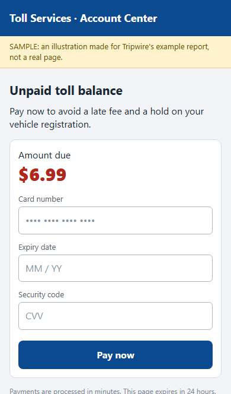

# Phish Finder



## Inspiration

Scam texts (fake tolls, missed deliveries, bank alerts) reach everyone, and older relatives often can't tell a real one from a fake. Asking someone means waiting for an answer, and tapping the link is where the danger is. We bring you Phish Finder: forward the text, and we open the link so you don't have to.

## What it does

1. You forward a suspicious text to Phish Finder over iMessage.
2. We open the link in a sandboxed browser, set up to look like an iPhone, on a cloud server.
3. We collect evidence: threat feeds, domain age and registration, and what the page asks for.
4. A points table decides the verdict: **Dangerous**, **Suspicious**, **No red flags found**, or **Couldn't check**.
5. About 20 seconds later you get a screenshot of the page, the verdict, plain-English reasons from Gemini, and a link to a full report.

We never call a link "safe", because no checker can promise that.

## How we built it

A TypeScript gateway on Photon Spectrum talks iMessage. A Python FastAPI analyzer drives Playwright Chromium in Docker and streams each step to a live dashboard. Evidence comes from Google Safe Browsing, URLhaus, OpenPhish, RDAP and the Tranco list. Gemini only reads screenshots people send and writes the explanation; the points table decides the verdict. The React report page, verdict card and link-preview image share a Frutiger Aero style. Caddy sits in front, and it all runs on one Google Cloud VM.

## Accuracy

Run on the deployed system, through the same call a phone text uses ([`docs/accuracy.md`](docs/accuracy.md)):

- **10 of 10** recent scam links flagged Dangerous or Suspicious
- **5 of 5** well-known real sites came back "No red flags found"
- **9.8 seconds** median time per check

Because scams from threat feeds are listed by definition, the table also shows a "Without blocklists" column: the same scans with feed points removed. Six of the ten scams were already offline when we opened them, so only the blocklists caught those. Of the four that loaded, the sandbox and domain checks alone flagged 2 and missed 2 login pages (2 of 10 overall).

## Challenges we ran into

- **Opening hostile links safely.** We block private and cloud-metadata addresses on every request and every redirect hop, and added an egress firewall as a second wall.
- **Scam links are often gone by the time we open them.** Those can't be judged, so they end as "Couldn't check" with the reason shown first, never as a clean result.
- **Link previews don't run web apps.** A shared report link needed its own server-rendered preview tags and a picture, so we draw one per report.
- **Slow AI answers.** Gemini gets 6 seconds and then the plain wording goes out instead; the verdict never depends on it.
- **Real sites that refuse robots.** Several major banks and delivery sites block automated browsers, so we show "Couldn't check" for them rather than guess.

## Accomplishments that we're proud of

- A real phone gets a real screenshot and verdict back with the laptop closed.
- 10 of 10 live scams flagged, and none of 5 real sites flagged.
- The Frutiger Aero look: a live dashboard of floating verdict bubbles and a glossy verdict card.

## What we learned

- Blocklists catch most scams, but the sandbox has to cover the fresh ones.
- A rules table is easier to trust and to test than letting an AI decide.
- Scam links die fast, so speed matters.

## What's next for Phish Finder

- Read the screenshot for scam wording (like "verify your account") so brand-new login pages get caught even before any blocklist has them.
- Family mode, where a guardian gets an alert when someone they protect receives a dangerous scam. It is built and tested; we are finishing real-phone testing.
- A live iMessage card that updates in place.

## Safety

- Private, loopback and cloud-metadata addresses are blocked on every request and every redirect; only `http` and `https` are allowed.
- The browser only looks: it never types, clicks, submits or downloads, and each scan gets a fresh, discarded browser.
- It runs on a dedicated VM behind an egress firewall.
- Every link we send back is defanged (`hxxps://example[.]com`), so it can't be tapped by accident.
- Each sender is rate-limited, and phone numbers are salted and hashed in logs.

## Run it yourself

Python 3 and Node.js; a Windows shell is shown, use `.venv/bin/python` on macOS or Linux.

```
# analyzer, from analyzer/
python -m venv .venv
.venv\Scripts\python -m pip install -r requirements-dev.txt
.venv\Scripts\python -m playwright install chromium
.venv\Scripts\python -m uvicorn main:app --port 8001
.venv\Scripts\python -m pytest -m "not network"

# gateway, from gateway/ (npm install first)
npm run check -- "example.com"     # one message through the real handler, printed; needs the analyzer running
npm test

# web, from web/ (npm install first)
npm run dev                        # opens on localhost:5173 ; /r/sample is the example report, /card-gallery the cards
npm test
```

Keys and settings go in a repo-root `.env`; copy the names from [`.env.example`](.env.example). Without any keys the analyzer still runs, and checks that need a key report "not checked". Deploying to a VM with HTTPS and the egress firewall is in [`deploy/DEPLOY.md`](deploy/DEPLOY.md).

## Citations

- Background artwork: Frutiger Aero Archive
- Fredoka font (SIL Open Font License)
- Threat data: Google Safe Browsing, URLhaus, OpenPhish, RDAP, Tranco list
- Messaging: Photon Spectrum
- We used AI coding assistants to help write, test and debug code. We planned the system, made the design decisions, and tested it on real phones.

## Team

- Joseph Liu
- Peter Karamanov
- Srijith Chandrasekar

<sub>The internal codename `tripwire` appears in environment variables, container names and ops scripts.</sub>
